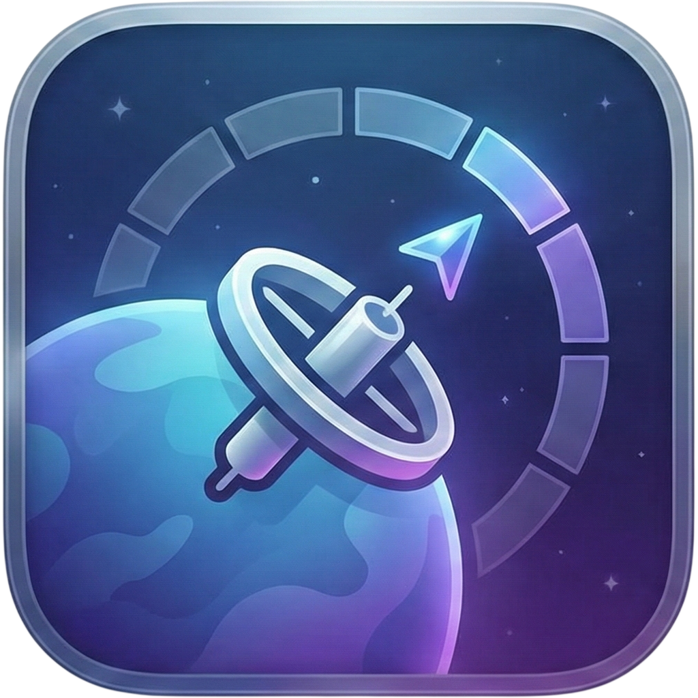

# SpaceStation

  

A macOS menu bar app for naming and managing Spaces (virtual desktops).

## Features

- Custom names for each Space (instead of "Desktop 1", "Desktop 2", etc.)
- Menu bar display showing current Space name
- Keyboard shortcuts to switch between named Spaces
- Persistent storage of Space names

## Requirements

- macOS 13.0+
- Xcode 15.0+

## Development

Built with Swift and SwiftUI.

## License

MIT
